<h1 align="center">Daniel Machado</h1>
<h3 align="center">Software Engineering Student &middot; game dev, web, and AI/LLM tooling</h3>

  
  
  

---

### About me

- 🔭 Building **FluidVision** (a Flutter family TV app), **TankGame** (Godot/C# + Cloudflare) and **Lundrea Arcade** (browser games)
- 🤖 Into **AI-driven development**: my own Claude Code agent harness with a safety decision engine and voice control, and a voice tutor that teaches from my lecture material
- 🌱 Learning **C++ (hand-rolled raylib engine), ML from NumPy to a GPT in PyTorch, security, and Android (Kotlin)** — [preparationSemester6](https://github.com/DaMacDev/preparationSemester6)
- 🧰 Running a small fleet of **self-hosted services** — VPN, password vault, error tracking, local AI stack
- 💬 Ask me about **TypeScript, Godot/C#, Flutter, Python tooling**, or running your own infrastructure
- 📦 ~50 active repos, most of them private labs and works-in-progress — links below go to what's public
- 🎓 Software Engineering student, graduating **July 2027**

---

### 💻 Tech stack

<!-- TECHSTACK:START -->
<!-- Generated by claude-infra/scripts/Sync-AuthorCard.ps1 -Profile from manifest/identity.json. Do not edit by hand. -->
                            
<!-- TECHSTACK:END -->

---

### 📺 Apps & self-hosted
- **[FluidVision](https://github.com/DaMacDev/FluidVision-releases)** — family TV app for your own Xtream IPTV subscription on Android, Android TV and Windows: per-person profiles, kids' guardrail, history that follows you across paired devices, auto-update, no tracking. **Flutter / Dart**. *(source private; downloads public)*
- **[Chorvi](https://aoglopgaver.web.app)** — multi-family chore-tracking PWA with parental approval, points, achievements and a gamified child UI, on Firebase's free tier. **TypeScript / Firebase**. *(live; source private)*

### 🎮 Games
- **[TankGame](https://github.com/DaMacDev/TankGame)** — real-time multiplayer tank arena. **Godot 4.6 / C#** on Android with an authoritative server on **Cloudflare Workers + Durable Objects**, CI/CD and architecture tests.
- **[Lundrea Arcade](https://lundrea-arcade.web.app/)** — a small arcade of browser games (Mastermind with anonymous daily + all-time leaderboards). **TypeScript / Canvas / Firebase**. *(live; source private)*
- **Hoard** — isometric co-op survival roguelike. **Unity 6.3 / C#**. *(team project, private)*

### 🤖 AI & dev tooling
- **studyTutor** — voice tutor over your own lecture slides and notebooks: narrates with live highlights, takes interruptions, quizzes and grades you. **Python / Claude**. *(private)*
- **CommandCenter** — localhost control plane for my Claude Code agents: system graph, safety decision engine, voice loop, task queue. **Next.js / TypeScript**. *(private)*
- **PoETools** — twelve rule-abiding Path of Exile 1 & 2 tools: death-cam, boss alerts, build checks via headless Path of Building. **Python**. *(private)*

### 🛠️ Web & small tools
- **[chimney-service](https://github.com/DaMacDev/chimney-service)** — *Riviera Hearth*, a bilingual (EN/ES) marketing site for a Cancún hotel chimney service. **TypeScript**.
- **[calendarInport](https://github.com/DaMacDev/calendarInport)** — import every FIFA 2026 World Cup match into your calendar, in Danish time with broadcaster info. **Python**.

---

### 📊 GitHub

  
  

---

Repos are tagged by topic (`game` · `app` · `web` · `tool` · `ai` · `self-hosted`) so related work groups together. Vendored/third-party clones are archived and hidden from the default list.
